**WordPress Developer · Software QA Engineer** 
I build useful web experiences and test software so people can trust it. 
CSE undergraduate · Dhaka, Bangladesh

I develop responsive WordPress sites and custom Elementor plugins, and bring a quality-first mindset to web applications through structured testing, clear defect reports, and automation.

## Experience

- **QA Engineer Intern · UnidevGo Software Solutions Ltd** — Feb 2026–present · Full-time · Remote 
  Review requirements, design functional/regression/smoke tests, and track defects through retesting and sign-off in Jira.
- **WordPress Developer · Codify Core Solutions** *(formerly SWISSTECH Services)* — Aug 2024–present · Remote 
  Build and customize client sites, develop Elementor plugins, integrate e-commerce and Fluent tools, and implement responsive designs from Figma.
- **Junior Web Developer (part-time) · DrawDown Markets**

## WordPress development

- [**Click-to-Copy Elementor widget**](https://github.com/mr-tanzim-ahmed/click-to-copy-button-elementor-widget) — custom PHP/JS/CSS widget with clipboard fallback, ACF Dynamic Tags, and styling controls.
- [**ACF Taxonomy Filter for Elementor**](https://github.com/mr-tanzim-ahmed/ACF-Taxonomy-Filter-for-Elementor) — filters Elementor Pro Loop Grids by taxonomy with instant client-side filtering.
- **Selected sites I've built, among many others:** E-commerce — [Azeerwear](https://azeerwear.com), [Bengal Vibes](https://bengalvibesbd.com); LMS — [Seven Stars](https://sevenstars.com); business — [Codify Core](https://codifycore.com), [Brandmark Consultancy](https://brandmarkconsultancy.com), [DrawDown Markets](https://drawdownmarkets.com/); niche — [DigiProdPass](https://digiprodpass.com), [Future Prop Firms Reviews](https://futurespropfirmsreviews.com), [Sazzad Ahsan](https://sazzadahsan.com).

## Software quality & testing

- [**Manual Testing portfolio**](https://github.com/mr-tanzim-ahmed/Manual-Testing) — requirements analysis, test planning, test cases, and bug reports.
- **Automation projects:** [Flextable plugin](https://github.com/mr-tanzim-ahmed/wordpress-plugin-automation-testing) · [WooCommerce](https://github.com/mr-tanzim-ahmed/Woocommerce-Plugin-AutomationTesing) · [ParaBank](https://github.com/mr-tanzim-ahmed/seleniumWithPom) · [API testing](https://github.com/mr-tanzim-ahmed/apiAutomation).
- **Mobile testing:** [EMI Calculator](https://github.com/mr-tanzim-ahmed/emiCalculatorAppAutomationWithPom) · [Simple Calculator](https://github.com/mr-tanzim-ahmed/simpleCalculatorAppAutomation).

## Other projects

- [**CSE AI Chat Mentor**](https://github.com/mr-tanzim-ahmed/CSE-AI-Chat-Mentor) — bilingual study companion with chat and voice features.
- [**Web project collection**](https://github.com/mr-tanzim-ahmed/Web-Project) — browser-based tools and games, including [Bangla OCR](https://github.com/mr-tanzim-ahmed/Web-Project/tree/main/Bangla%20OCR%20Engine) and [Chess](https://github.com/mr-tanzim-ahmed/Web-Project/tree/main/Chess%20Games).
- [**BDT Exchange Hub**](https://github.com/mr-tanzim-ahmed/BDT-Exchange-Hub) · [**Hospital Management DBMS**](https://github.com/mr-tanzim-ahmed/Database-Project-Hospital-Management-System)

## Toolkit

**WordPress development:** `WordPress` · `Elementor` · `BeTheme` · `PHP` · `JavaScript` · `CSS` · `ACF` 
**Plugins & integrations:** `WooCommerce` · `MasterStudy LMS` · `Tutor LMS` · `Slider Revolution` · `FluentCart` · `Fluent Forms` · `Fluent Auth` · `FluentSMTP` · `Contact Form 7` 
**Quality engineering:** `Test design` · `Jira` · `Java` · `Selenium` · `TestNG` · `REST Assured` · `Appium` · `Postman` · `JMeter` 
**Workflow:** `Git` · `GitHub Actions` · `Figma` · `Rank Math` · `Yoast SEO`

*Open to opportunities in software quality assurance and WordPress development.* 
[Email me](mailto:mr.tanzim.ahmed@gmail.com) · [Connect on LinkedIn](https://www.linkedin.com/in/mr-tanzim-ahmed/)

